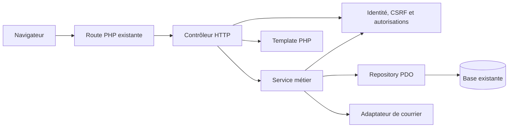

# Architecture cible : PHP natif structuré

**Proposition du 3 novembre 2026**, fondée sur l’[audit](audit.md) de `develop` au commit `614eb9c`. Elle n’est pas encore validée pour implémentation. Voir le [plan](plan-migration.md), les [tickets](backlog.md) et l’[historique](historique.md).

## Principes et périmètre

- Moderniser progressivement le monolithe, sans réécriture totale ni framework complet imposé.
- Préserver comptes, mots de passe, listes, idées, droits, réservations, relations et données archivées ; aucune transformation destructive de la base de production.
- Garder routes et liens existants ou fournir des redirections compatibles et testées. Toutes les permissions sont appliquées côté serveur.
- Séparer corrections fonctionnelles et extraction architecturale ; maintenir les comportements validés pendant les refactorisations.
- Ajouter des abstractions proportionnées et compréhensibles par un développeur seul. PSR-4 et PSR-12 s’appliquent au nouveau code sans reformatage massif du legacy.

## Comparaison actuelle / cible

| Sujet | Actuel à la référence auditée | Cible progressive |
|---|---|---|
| HTTP | Pages et scripts PHP accessibles individuellement. | Routes conservées comme adaptateurs vers de nouveaux traitements. |
| Responsabilités | SQL, règles et HTML mélangés. | Contrôleurs fins, services métier, repositories PDO, templates. |
| Identité | Session et rôle en partie initialisés par les pages et la navigation. | Initialisation commune ; compte actif et autorisations vérifiés avant action. |
| Données | PDO global et SQL dispersé. | Une connexion PDO passée explicitement aux repositories. |
| Configuration | URL et secrets dans le code. | Configuration privée protégée et vérifiée au démarrage. |
| Qualité | Aucun lanceur de tests ou schéma SQL suivi trouvé. | Tests ciblés, analyse progressive et CI. |



Ce diagramme décrit une direction, non une implémentation existante. Les frontières de transaction sont explicites ; l’échec d’un courriel ne doit pas masquer l’état SQL.

## Structure indicative

```text
pages/                 Routes existantes pendant la transition
scripts/               Adaptateurs historiques et bootstrap transitoire
css/, js/, images/     Ressources publiques existantes
src/
  Controller/          Requête, réponse et validation HTTP
  Service/             Règles et orchestration métier
  Repository/          Requêtes PDO
  Security/            Session, identité, permissions et CSRF
  Support/             Configuration et utilitaires partagés nécessaires
templates/             HTML PHP et composants
config/                Configuration non sensible et exemples
database/              Migrations additives et description du schéma
tests/                 Tests unitaires, HTTP et SQL isolés
```

`public/` et un point d’entrée unique restent conditionnés aux capacités LWS et aux bénéfices réels. `Entity/` n’est pas obligatoire : introduire un objet métier seulement lorsqu’il simplifie le code. Aucun conteneur d’injection ou framework maison n’est nécessaire initialement.

| Couche | Responsabilité et dépendances admises | À exclure | Exemple issu du projet |
|---|---|---|---|
| Route / contrôleur | Lit et valide la requête, appelle sécurité et services, produit une réponse. | SQL métier et sécurité limitée au rendu. | La route [idees](../../pages/idees/index.php#L18) délègue la réservation. |
| Service | Règles, orchestration et transaction ; reçoit identité et repositories. | `$_POST`, HTML et requêtes dans le rendu. | Vérifier qu’une idée active non achetée est réservable par l’utilisateur. |
| Repository | SQL préparé avec PDO et données retournées. | Courriel, présentation et décisions de rôle. | Charger idée, liste et états par ID. |
| Security | Session, compte actif, droits, CSRF. | Rendu de page. | Exiger propriétaire pour gérer les droits d’une liste. |
| Templates | HTML, composants, échappement et conditions simples d’affichage. | Écritures, SQL et contrôle d’accès unique. | Remplacer les requêtes dans le rendu de [idees](../../pages/idees/index.php#L206). |
| Bootstrap / configuration | Paramètres privés et création explicite des dépendances. | Secrets versionnés et métier. | Extraire la connexion de [verif](../../scripts/verif/index.php#L1). |
| Database / tests | Migrations additives et jeux synthétiques isolés. | Secrets et exports de données réelles. | Tester droits et anciens formats de mot de passe. |

## Choix techniques et alternatives

| Besoin | Natif / personnalisé | Bibliothèque spécialisée | Recommandation |
|---|---|---|---|
| Routage | Routes existantes ; routeur maison à entretenir. | Routeur léger si besoin avéré. | Conserver les URL ; pas de contrôleur frontal obligatoire au départ. |
| Vues | Templates PHP et échappement explicite. | Twig et échappement automatique. | PHP d’abord ; réévaluer si complexité accrue. |
| Données | PDO et repositories. | DBAL si les besoins SQL deviennent complexes. | PDO existant, transactions par action. |
| Dépendances | `require` manuels possibles. | Composer, PSR-4, versions verrouillées. | Composer local/CI, sans supposer sa présence sur LWS. |
| Validation | Contrôles explicites et fonctions courtes. | Validateur spécialisé si nécessaire. | Natif pour les besoins actuels. |
| Sessions / mots de passe | Sessions PHP et `password_verify`. | Composant ciblé pour besoins avancés. | Conserver les sessions et le fallback historique ; réparer récupération et initialisation. |
| Permissions / CSRF | Service simple et jeton de session testés. | Composants maintenus si complexité réelle. | Règles explicites par action, refus par défaut ; ne pas inventer une plateforme de sécurité. |
| Erreurs | Gestionnaire central et journaux. | Bibliothèque de logs si utile. | Erreurs publiques génériques, logs sans secrets. |
| Tests / migrations | Tests et SQL versionnés. | PHPUnit, PHPStan, outil de migration éventuel. | Tests et analyse progressifs ; SQL additif simple initialement. |

## Frontend : trois options

Les [styles existants](../../css/style.css#L1) ont déjà des variables clair/sombre et des adaptations mobiles ; [navbar](../../widgets/navbar/index.php#L1) possède un lien d’évitement et un menu mobile. Aucun test visuel ou audit d’accessibilité en situation n’a été réalisé.

1. **Bootstrap personnalisé — recommandé :** déjà présent, transition limitée ; compléter par tokens sémantiques et composants PHP.
2. **Material Web :** composants inspirés de Material ; nouvelle dépendance et maintenance à évaluer. Le projet indique être en [mode maintenance](https://material-web.dev/).
3. **Petit ensemble CSS propre :** contrôle visuel fin ; éviter de recréer inutilement dialogues et interactions accessibles complexes. Il peut compléter Bootstrap.

Moderniser une page à la fois, en commençant par les listes, puis détail et formulaires. Tester clavier, lecteur d’écran, contrastes, zoom, erreurs, mobile et thème sombre. Ne pas déclarer une conformité RGAA sans audit dédié. Vérifier l’usage de jQuery avant tout retrait ; son fichier et le README divergent sur la version.

Les métadonnées Figma consultées montrent une page mobile de partage et une page web avec cartes, barres et formulaires. Elles ne prouvent pas la fidélité d’une future interface. La page historique des groupes familiaux est exclue : leur abandon est une décision explicite. Les issues Flutter sur les [membres](https://github.com/Thematt69/listes_idees_cadeaux/issues/154), la [réservation](https://github.com/Thematt69/listes_idees_cadeaux/issues/148), l’[archivage](https://github.com/Thematt69/listes_idees_cadeaux/issues/149) et les [images](https://github.com/Thematt69/listes_idees_cadeaux/issues/152) sont des références fonctionnelles, pas des preuves de fonctions PHP existantes.

## PWA et photos : fonctionnalités distinctes

- **Installation Android :** manifest, icônes, `start_url`, périmètre et HTTPS ; vérifier les critères du navigateur ciblé.
- **Service worker :** optionnel selon le besoin ; commencer par les ressources statiques. Ne pas placer pages authentifiées, listes privées ou jetons dans un cache partagé.
- **Hors ligne :** aucune écriture de réservation hors ligne sans stratégie explicite de synchronisation et de conflits.
- **Web Push :** consentement, abonnements, service worker, clés et mécanisme d’envoi ; distinct des notifications internes actuelles.
- **Photos :** taille et type réels vérifiés, noms générés, éventuel réencodage, stockage non exécutable et contrôle de lecture. Capacités LWS inconnues.

## Déploiement et alternative framework

Privilégier des fichiers privés hors document root ; si impossible, démontrer par des tests le refus des accès directs, y compris aux fichiers non PHP. Les capacités diffèrent selon l’offre : voir les documentations LWS sur [cPanel](https://aide.lws.fr/base/cPanel/Gestion-des-noms-de-domaine/creer-un-sousdomaine-dans-cPanel) et [LWS Panel](https://aide.lws.fr/base/Noms-de-domaine/Gerer-un-nom-de-domaine/sous-domaines). L’offre exacte reste inconnue. L’artefact Composer doit être construit en CI, avec dépendances de production verrouillées ; transport chiffré, compatibilité des extensions et rollback doivent être vérifiés. Voir le [plan](plan-migration.md#déploiement-et-retour-arrière).

L’option D est raisonnable pour les parcours observés. Laravel ou Symfony mériteraient une réévaluation si rôles, API, intégrations, traitements asynchrones, exploitation ou taille d’équipe rendaient objectivement plus coûteux le maintien des mécanismes transverses. Aucun tel besoin ne justifie aujourd’hui une migration par défaut.
